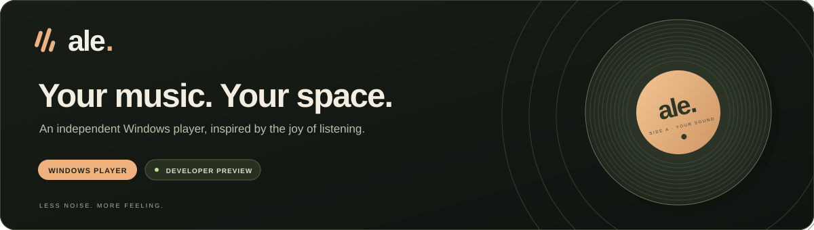
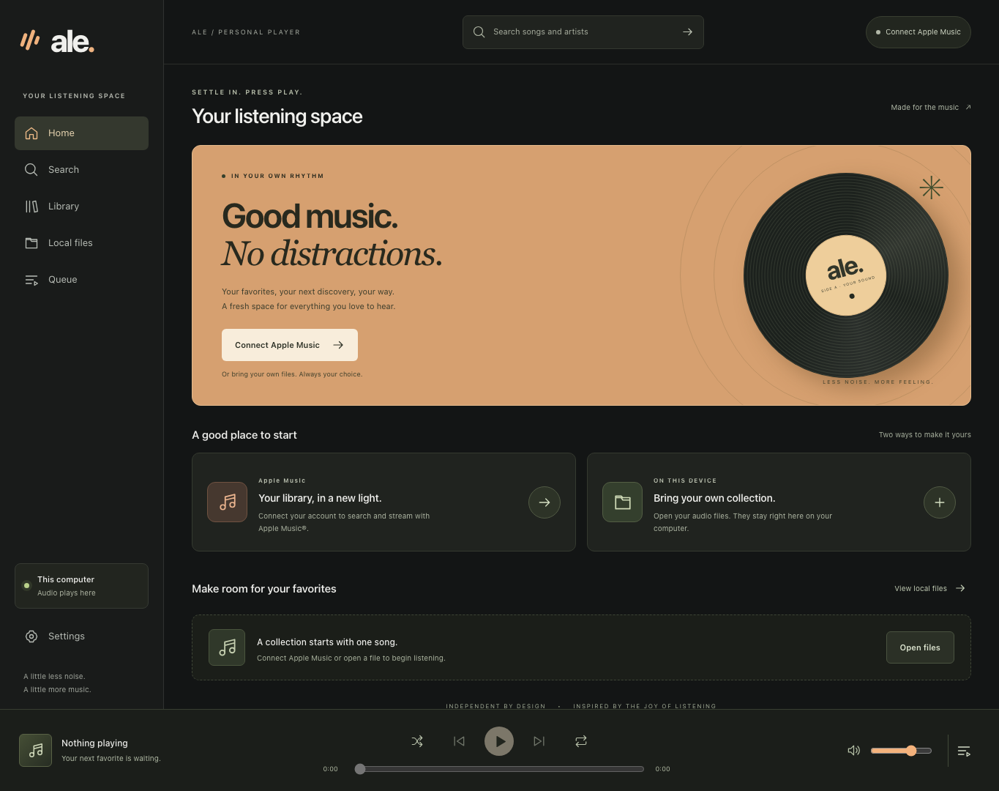

<div align="center">



**A Cider-inspired music player with its own name, code, and character.**


[Get started](#get-started) · [Mac & Xcode](docs/guides/macos.md) · [Windows Apple Music setup](docs/guides/apple-music.md) · [Build & test](docs/guides/development.md) · [Privacy](docs/legal/privacy.md)

</div>

---

Ale brings local audio and an official Apple Music® integration into a quiet, focused desktop app for **Windows and Mac**. Both platforms share the same React and TypeScript interface. Windows uses .NET and WebView2; macOS uses a native Swift/WebKit host and Apple's MusicKit framework.

> [!IMPORTANT]
> **This is a developer preview.** The Mac app builds for Apple silicon and Intel, both Xcode projects compile, and local WAV import/playback has been observed in the native Mac app. Real Apple Music subscription playback still needs a signed app and live account test. Windows startup and full protected playback remain unverified on a Windows PC. The iPhone remote is a later milestone.



## What’s inside

| Your music                                          | Your listening space                                         |
| --------------------------------------------------- | ------------------------------------------------------------ |
| Open local MP3, WAV, M4A, AAC, OGG, and FLAC files¹ | Play, pause, seek, skip, and adjust volume                   |
| Connect through official MusicKit authorization     | Queue tracks, shuffle, and repeat                            |
| Search the Apple Music catalog                      | Keyboard controls, visible focus, and screen-reader labels   |
| Browse catalog-backed songs from your library²      | Reduced motion, responsive layout, and high-contrast support |
| Keep local files on your computer                   | No Ale accounts, ads, analytics, or rented server            |

¹ Format support depends on the playback runtime. On Mac, Apple Music volume uses system controls; Ale's volume slider remains available for local files. ² Library is limited to 100 songs. Windows/browser playback uses catalog-backed library items; the Mac port requests native playable songs. Library pagination is not implemented.

## Get started

| Platform                          | Runtime                        | Build command           | Output                           |
| --------------------------------- | ------------------------------ | ----------------------- | -------------------------------- |
| macOS 14+ · Apple silicon & Intel | Swift, WebKit, native MusicKit | `npm run macos:build`   | `build/releases/macos/Ale.app`   |
| Windows 11 · x64                  | .NET 10, WebView2              | `npm run windows:build` | `build/releases/windows/Ale.exe` |

### Run the Mac preview

With **Node.js 24** and **Xcode** installed, run from the repository root:

```sh
npm ci
npm run macos:build
```

Open `build/releases/macos/Ale.app` and choose **Open files** to play unprotected audio you have the right to use. This is an ad-hoc signed local development build, not a notarized public release.

For Xcode development, run `npm run macos:prepare`, then open **[desktop/macos/Ale.xcodeproj](desktop/macos/Ale.xcodeproj)** and choose **Ale → My Mac**. Native Apple Music requires your own development team, a registered app identifier with MusicKit App Service, and an active subscription. **No developer JWT is pasted into the Mac app.** Follow the [Mac setup guide](docs/guides/macos.md) for signing, privacy, platform differences and remaining tests.

### Run the Windows preview

Build from source using the instructions below, or use an Actions artifact if one has been generated for the commit you want to test. A build workflow is included; no published release is promised by this README.

If you already have `Ale-win-x64-preview.zip` from a local build:

1. Transfer it to your **Windows 11 x64** PC.
2. Extract the **entire folder**; keep `wwwroot` and the DLLs beside `Ale.exe`.
3. Open **Ale.exe**, choose **Open files**, and try an unprotected audio file you own.
4. Follow the [Apple Music setup guide](docs/guides/apple-music.md) to connect your account.

The [.NET runtime](https://dotnet.microsoft.com/download/dotnet/10.0) is bundled in the Windows build. The playback PC needs [Microsoft WebView2 Evergreen Runtime](https://developer.microsoft.com/microsoft-edge/webview2/). This preview is unsigned; follow your Windows and organization security policies.

### Run from source

Requires **Node.js 24**. Run these commands from the repository root:

```sh
npm ci
npm run dev
```

Open the local URL Vite prints. This starts the interface in a browser; it does not launch the Windows executable.

<details>
<summary><strong>Build a dedicated Windows app</strong></summary>

Install the **.NET 10 SDK** on your build machine, then run:

```sh
npm run windows:build
```

The script builds the frontend, checks the native navigation policy, publishes the self-contained Windows x64 app, and gathers dependency notices into:

```text
build/releases/windows/
```

Building on macOS is supported; running the resulting executable requires Windows. Apple credentials are not needed to compile. See the [development guide](docs/guides/development.md) for requirements, commands, and CI details.

</details>

<details>
<summary><strong>Connect Apple Music on Windows or in a browser</strong></summary>

You need an **Apple Developer account**, a MusicKit media identifier/private key, and an **active Apple Music subscription** for full tracks.

Generate a signed developer token locally, then enter it in **Ale → Settings → Developer token**. Finish authentication in Apple’s own window.

**Never commit a token or private key, and never paste your `.p8` signing key into Ale or an issue.** The [Apple Music guide](docs/guides/apple-music.md) walks through setup, token generation, and the first Windows playback test.

</details>

## Built with care, still a preview

The Mac port adds native security checks and adapter regressions to the shared player suite. The verification record includes **22 unit tests, 9 browser scenarios in each of Chromium and WebKit, and 23 Mac navigation/resource/bridge assertions**. Both Mac architectures compile; the portable Xcode project and the owner's original project build. Tested states reported no axe violations for the selected WCAG rule tags. These are recorded test results, not a live CI badge or a full accessibility audit.

Live protected playback, Apple’s own dialogs, VoiceOver/Narrator, display scaling, and release-specific legal requirements remain open checks. Read the [verification record](docs/verification.md) and [compliance/release checklist](docs/legal/compliance.md) for the exact limits.

## Vibe-code disclaimer

**Yes, Ale is vibe-coded.** This personal project was built with substantial AI assistance for implementation, documentation, and tests, including an AI code-review pass.

AI-generated code can contain mistakes, fragile assumptions, and security or accessibility problems. Passing tests does not establish that every feature works on every machine, and this project has not received a full human security, accessibility, or legal audit. Treat it as experimental software, review changes before relying on them, and report reproducible problems without sharing secrets. This disclosure does not waive legal obligations or establish that the output is non-infringing.

## Around the repository

```text
ale/
├── src/              Shared interface, components and playback logic
├── desktop/          Native app projects
│   ├── macos/        Swift host, Xcode project and native checks
│   └── windows/      .NET/WebView2 host and native checks
├── scripts/          Tools grouped into macos, windows, apple-music and dev
├── tests/            unit/ regressions and e2e/ browser scenarios
├── public/           Original app assets
├── docs/             guides/, legal/, architecture/, plans/ and images/
├── .github/          CI workflows and contribution instructions
├── build/            Generated apps, frontend, Xcode data and test results*
└── local/            Preserved exports, research and scratch work*
```

\* Local folders excluded from Git. See the [folder guide](docs/architecture/repository-layout.md) and [documentation index](docs/README.md). Standard Vite, TypeScript, lint and formatting configuration stays at the root for tool discovery.

## Contributing

Small, focused fixes are welcome. Include reproduction steps, the affected platform, and relevant test results. For Apple Music issues, explain whether the failure occurs in Edge, the Windows app, or both. **Do not attach developer tokens, passwords, private keys, or browser profiles.**

See the [contribution guide](.github/CONTRIBUTING.md) for the development workflow.

## Credits & licensing

Ale is inspired by Cider’s purpose, with original Ale source, branding, and artwork. No Cider source, assets, binaries, or tokens are included. Ale is not affiliated with Apple or Cider. Apple and Apple Music are trademarks of Apple Inc., registered in the U.S. and other countries.

A license for **Ale’s own source code has not been selected yet**; do not assume an open-source license. Third-party terms and notices are listed in [THIRD_PARTY_NOTICES.md](THIRD_PARTY_NOTICES.md) and included with packaged builds.

---

<div align="center">

**Less noise. More feeling.**

[Privacy](docs/legal/privacy.md) · [Verification](docs/verification.md) · [Release review](docs/legal/compliance.md)

</div>
